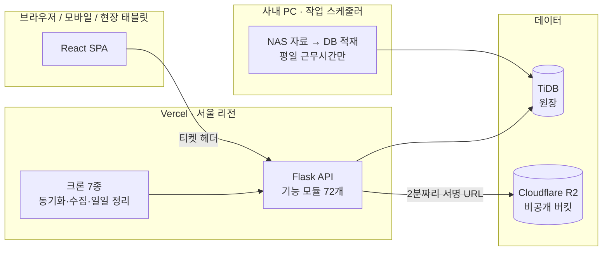

# 프로젝트 상세 — 어떻게 만들고, 어떻게 운영하는가

> [← 프로필로 돌아가기](README.md)

두 프로젝트 모두 **혼자 기획·개발·배포·운영**합니다. 여기서는 "무엇을 만들었는가"보다
**"어떤 문제를 어떤 구조로 풀었고, 운영에서 무엇을 겪었는가"** 를 적습니다.

| | HSMnT (사내 업무 포털) | AI Bunker (개인 포털) |
| --- | --- | --- |
| 성격 | 제조업 현장·경영지원 업무 시스템 (비공개) | 개인 서비스 [aibunker.kr](https://aibunker.kr) |
| 프론트 | React 18 · TypeScript · Vite · Tailwind · TanStack Query | Jinja 템플릿 + 일부 React SPA |
| 백엔드 | Flask 3 · SQLAlchemy 2 · 기능 모듈 72개 | Flask 블루프린트 25개+ |
| 데이터 | TiDB(MySQL 호환) · Cloudflare R2 | TiDB · Cloudflare R2 |
| 배포 | Vercel 서버리스(서울 리전) + git push 자동배포 | Vercel 서버리스 + Cloudflare |
| 규모 | 커밋 2,250+ (약 12주) · 테스트 파일 125+ | 커밋 1,800+ · 스크립트 230+ |

---

## 1. HSMnT — 사내 경영지원·생산 통합 포털

### 왜 만들었나
근태·연차·급여명세서·채용·도면·생산 작업이 **엑셀·종이·여러 사내 시스템에 흩어져** 있었습니다.
해법은 "엑셀을 더 잘 만드는 것"이 아니라 **엑셀을 한 번 DB로 옮겨 적재하고, 그 순간부터 DB를 원장(원본)으로 삼는 것** 이었습니다.
화면은 요청이 올 때마다 엑셀을 다시 여는 대신 DB만 조회합니다.

### 구조

- **기능 단위 모듈**: `backend/src/features/<기능>/`(모델·서비스·라우터)과 `frontend/src/features/<기능>/`이 쌍으로 움직입니다. 새 기능을 붙이는 절차는 문서로 고정해 두었습니다.
- **입구는 하나**: 로그인은 사번 + 개인 비밀번호 하나이고, 화면별 권한은 **서버가** 메뉴 키로 검사합니다(프런트의 숨김은 편의일 뿐).
  경영지원 전용 같은 민감 메뉴는 코드에 사람을 고정(`HARD_LIMITED`)해 관리자 화면에서도 넓힐 수 없게 했습니다.

### 운영 — 이렇게 돌립니다

| 영역 | 방식 |
| --- | --- |
| **배포** | `git push` → Vercel이 빌드·배포. 빌드 직전 스크립트가 백엔드 **주석·독스트링을 제거한 사본**을 만듭니다(Python은 minify가 없어 설계 판단이 담긴 주석이 그대로 배포되기 때문). AST로 처리해 문자열 속 `#`을 건드리지 않습니다. |
| **의존성 사고 방지** | 패키지 목록이 세 곳(`pyproject.toml`·`uv.lock`·`requirements.txt`)에 있어야 런타임에 뜹니다. 한 곳만 고치면 빌드는 통과하고 프로덕션 API가 죽는 사고가 있었고, 그 뒤로 **빌드 스크립트가 세 곳을 대조해 다르면 배포를 멈춥니다.** |
| **배포 후 확인** | 대시보드의 READY가 아니라 `/api/health`를 직접 호출해 200인지 봅니다. 빌드 성공과 런타임 부팅은 별개이기 때문입니다. |
| **용량 관리** | 배포 하나가 수백 MB라 무료 한도를 넘긴 적이 있어, 최신 3개와 현재 서비스 중인 배포만 남기는 정리 스크립트를 둡니다. |
| **예약 작업** | NAS 자료 동기화처럼 사내 PC에서만 되는 일은 Windows 작업 스케줄러로 돌립니다. 콘솔 창이 번쩍여 작업을 끊는 문제를 없애려고 전부 헤드리스(`conhost --headless`)로 등록하고, NAS를 읽는 작업은 **평일 근무시간에만** 돌게 두 곳(트리거·스크립트 첫머리)에서 막습니다. |
| **소유권·계정 이전** | 저장소를 다른 계정으로, 배포 팀 소유자를 다른 사람으로 옮길 때는 **이전 직후 빈 커밋을 푸시해 자동배포가 이어지는지** 확인합니다. 토큰은 옛 것을 만료시키고 **프로젝트 범위**로 새로 발급하며(만료일 기록), 커밋 작성자도 연결된 계정으로 맞춥니다 — 비공개 저장소 커밋자를 유료 좌석으로 세는 설정이 있어, 작성자가 다르면 비용이 생기거나 배포가 막힐 수 있기 때문입니다. |
| **문서 위생** | 규칙·README에 사람 이름·연락처·금액 같은 **개인정보나 자주 바뀌는 값을 적지 않고** 역할 표현과 코드 위치로 대체합니다. 값은 코드·DB가 정답이고 문서는 낡으면 믿을 수 없게 되기 때문입니다. 옮겨진 경로를 참조하는 문서·주석도 함께 고쳐 죽은 링크를 남기지 않습니다. |
| **일일 정리** | 크론이 하루 한 번 표 정합성·첨부 총량·신규 입사자 반영 등을 점검하고, 기준을 넘으면 로그에 경고를 남깁니다. |
| **여러 작업이 한 저장소를 동시에 건드릴 때** | 내 변경만 경로를 명시해 커밋하고, 낯선 변경은 되돌리지 않고 주인을 확인하는 규칙을 문서화했습니다. 푸시 뒤에는 로컬 브랜치를 원격에 맞춰 갈라짐을 막습니다. |

### 설계에서 신경 쓴 것

**① 날짜가 효력을 정한다 (상태값이 아니라)**
퇴직 "예정"을 미리 입력해 둬도 재직 여부·연차·로그인은 **입사일·퇴직일** 기준으로만 움직입니다.
상태값으로 재직을 가르면 아직 회사 사람인 사람이 계정·집계에서 사라지는 사고가 났고, 그래서 판정을 **모델의 단일 메서드(날짜 기준 판정)** 한 곳으로 모아 화면·집계·로그인이 모두 같은 기준을 쓰게 했습니다.
> 사용 기술: SQLAlchemy 모델 메서드 + SQL 조건 생성 함수(같은 규칙을 파이썬·SQL 양쪽에서 재사용)

**② 재고·생산 장부는 "추가만 하는 전표"로 (수정 대신 취소 전표)**
기존에 쓰던 상용 ERP의 생산 흐름을 포털로 옮겨 오며, 장부는 지우거나 고치지 않고 **반대 부호 전표를 새로 쓰는 방식**으로 만들었습니다.
저장은 한 트랜잭션에서 칸별 잔량을 정해진 순서로 잠그고, 음수가 되면 거절하고, 같은 요청이 다시 와도 한 번만 반영됩니다.
옮겨 온 과거 전표를 같은 규칙으로 **재생해 원래 재고와 100% 맞는지 대조**하는 스크립트로 규칙이 틀리면 바로 드러나게 했습니다.
> 사용 기술: 이벤트 소싱과 비슷한 추가 전용(append-only) 장부, DB 트랜잭션 + 행 잠금(`SELECT … FOR UPDATE`), 멱등 키, 이력 재생(replay) 기반 정합성 검증

**③ 개인정보는 열어 두지 않는다**
민감 컬럼은 암호화해 저장하고, 개인 서류(PDF)는 **비공개 버킷 + 2분짜리 서명 URL**로만 내려줍니다.
급여명세서는 금액은 본인에게 항상 보이고 PDF는 근태 서명 후에만 받게 서버가 다시 확인합니다.
공개 번들에 넣으면 로그인 없이 읽히는 자료는 프런트 코드에 넣지 않고 서버가 권한 확인 후 내려줍니다.

**④ 현장 태블릿 포털**
설비에 붙박이로 세운 태블릿은 개인 계정이 아니라 **구역 단위 공용 인증**으로 엽니다. 단순한 인증이라 실패 횟수 제한과
일괄 재로그인(버전 값으로 기존 세션 무효화)을 두었고, 구역끼리는 서로의 설비를 못 건드리게 서버가 막습니다.
같은 작업을 두 사람이 동시에 걸거나 끝내는 경우는 낙관적 동시성 검사로 서버가 거절합니다.
> 사용 기술: 토큰 기반 세션 + 버전 무효화, DB 기반 시도 횟수 제한, 낙관적 동시성 제어

**⑤ 도면 관리**
기존 외부 도면 서비스를 대체하는 사내 도면 원장. PDF·DWG 미리보기와 필기·스탬프는 브라우저(pdf.js·pdf-lib, LibreDWG wasm)가 처리하고,
파일은 브라우저가 비공개 버킷에 직접 올립니다. DWG 렌더링은 독립 렌더러와 **선만 대조**하는 검사 스크립트와 결함 사례 모음으로 회귀를 막습니다.

### 검증
- 테스트 파일 125+개(기능별 `test_*.py`) — 로컬 테스트는 운영 DB가 아닌 **격리 DB**에서 돌립니다.
- 급여·근태처럼 틀리면 안 되는 숫자는 "포털 화면 숫자 vs 엑셀 수식" 비교 스크립트로 업무일지 반영 직후 자동 대조합니다.
- 법정 하한이 있는 값(최저임금 등)은 외부로 나가는 문서에 쓰기 전에 하한부터 계산합니다 — 채용공고 급여를 "사내 자료와 일치"만 확인하고 올렸다가 반려된 경험에서 만든 규칙입니다.

---

## 2. AI Bunker — 개인 포털 ([aibunker.kr](https://aibunker.kr))

갤러리·블로그·다이어리·캘린더·GIS·3D 타자·리듬게임·심리/스크리닝 검사·가계부·학습자료를
**Flask 블루프린트 25개+** 로 한 앱에 묶은 개인 서비스입니다. 도메인마다 `routes.py` + `services.py` + `templates/<도메인>/`
구조를 지키고, 구조와 라우트는 한 문서(`BLUEPRINT_GUIDE.md`)에 모아 둡니다.

### 운영
| 영역 | 방식 |
| --- | --- |
| **배포** | Vercel 서버리스(함수 60초 제한 안에서 동작하도록 설계), 정적 자산은 장기 캐시(immutable) |
| **DB 백업** | TiDB 45개 표 전체를 저장소 **밖**으로 덤프(`jsonl.gz` + 스키마 + `sha256` 매니페스트)하고 외장 드라이브로 매주 미러링. 다시 만들 수 없는 데이터(GPS 84만 점, 방문 로그, 유료 호출로 만든 글)가 있어서입니다. 백업이 작업 폴더 안에 있으면 `git clean -fdx` 한 번에 원본과 같이 사라진다는 걸 실측하고 위치를 정했습니다. |
| **접근 권한 감사** | 모든 GET 라우트를 **익명 / 일반 회원 / 관리자** 세 세션으로 요청해 상태 코드를 비교하는 스크립트. 로컬에서는 자동 로그인 훅이 익명을 관리자로 덮어쓰는 함정이 있어 기준 주소를 운영 도메인으로 고정했습니다. |
| **콘텐츠 갱신** | 폰트 2,279종·스킬 425종·애니메이션 아이콘 1,233종 같은 오픈소스 자료는 스크립트로 수집·갱신하고, 라이선스를 확인한 것만 담습니다. |

### 설계 사례 — 서버리스에서의 로그인 무차별 대입 방어
서버리스는 프로세스 메모리에 횟수를 둘 수 없어 실패 기록을 DB에 남깁니다. IP 기준과 아이디 기준을 따로 세어
**여러 IP가 돌려 가며 한 아이디를 때리는 경우**도 막고, 방어 장치 자체가 로그인을 막지 않도록 DB 장애 시에는 통과시킵니다.
막힌 동안은 비밀번호를 대조조차 하지 않아 맞았는지 알려 주지 않습니다. IP는 원문이 아니라 해시로 저장하고, 오래된 기록은 자동으로 정리합니다.
> 사용 기술: DB 기반 슬라이딩 윈도우 제한(rate limit), IP 해시 저장, Cloudflare 헤더 기반 실제 접속자 IP 판별, 장애 시 열림(fail-open) 정책

---

## 3. 개발하는 방식

- 저장소마다 **규칙 문서(`CLAUDE.md`)** 에 구조·함정·결정 이력을 적어 두고, AI 코딩 에이전트(Claude Code)와 협업합니다.
  "무엇을 시킬지·무엇이 맞는지"의 판단과 검증은 제가 하고, 사고가 날 때마다 **재발 방지 규칙을 문서와 스크립트로 남기는 것**을 원칙으로 합니다.
- 위 표의 운영 규칙(의존성 대조, 배포 후 헬스 체크, 백업 위치, 권한 감사)은 대부분 **실제로 겪은 사고의 결과물**입니다.
